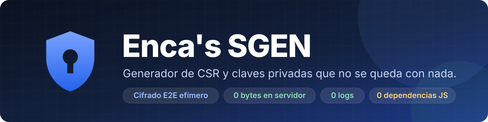
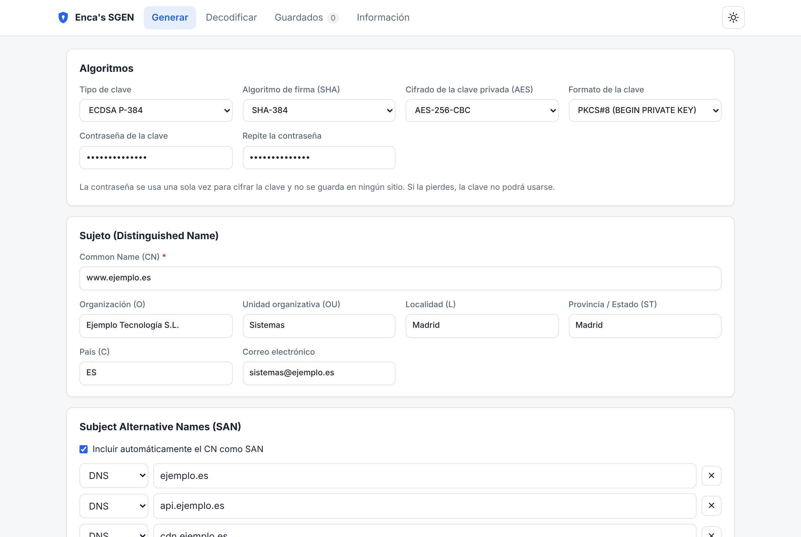
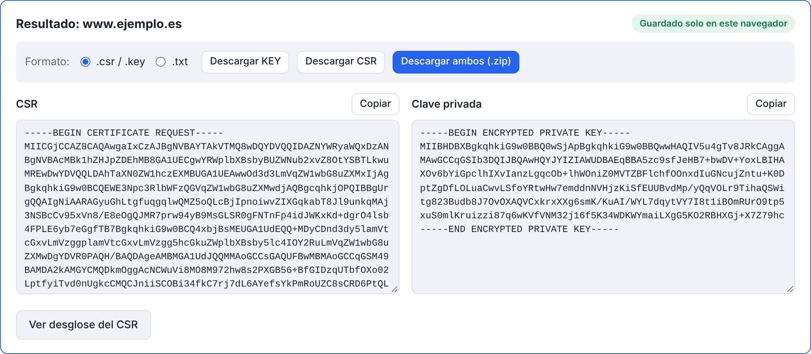
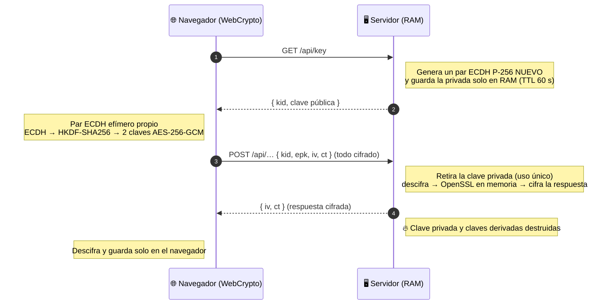
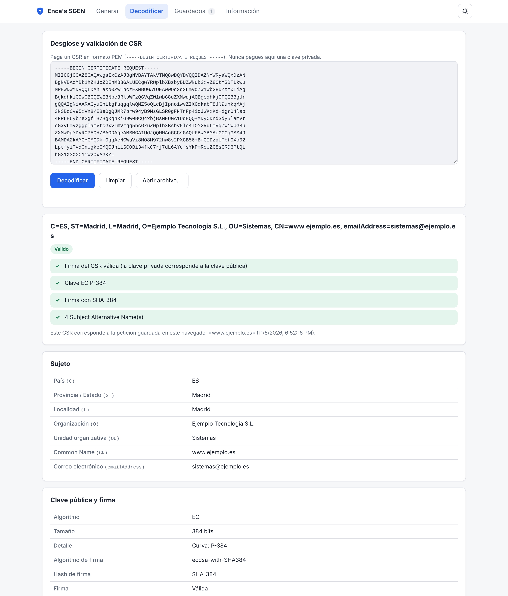
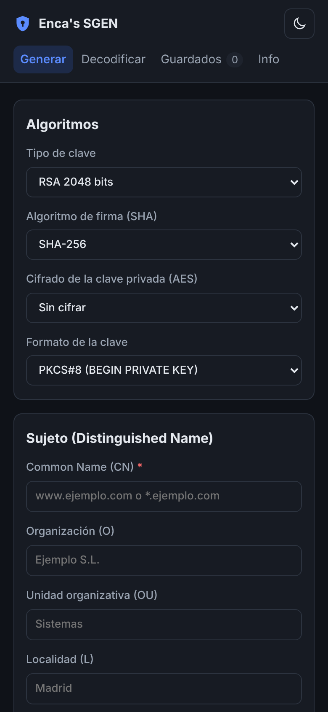

<div align="center">

<a href="https://sslgen.exala.es"></a>

<br>

[](https://sslgen.exala.es)
[](https://github.com/0xenca/openssl-web/actions/workflows/tests.yml)


**Genera tu CSR y tu clave privada con la tranquilidad de que el servidor no se queda con nada.**
<br>
Ni un fichero. Ni un log. Ni una clave. Ni una cookie.

<br>

[](https://sslgen.exala.es)

<sub>Gratis · sin registro · sin cookies · sin instalar nada</sub>

<br><br>

[Web oficial](https://sslgen.exala.es) ·
[Características](#-características) ·
[Seguridad](#%EF%B8%8F-seguridad-en-profundidad) ·
[Cómo funciona](#-el-cifrado-por-dentro) ·
[Capturas](#-capturas) ·
[Instalación](#-instalación-en-3-comandos) ·
[Configuración](#%EF%B8%8F-configuración)

</div>

<br>

<picture>
  <source media="(prefers-color-scheme: dark)" srcset="docs/screenshots/generar-dark.png">
  
</picture>

<p align="center"><sub>👆 Así se ve <a href="https://sslgen.exala.es"><b>sslgen.exala.es</b></a>. La captura cambia con el tema claro u oscuro de tu GitHub, igual que la web.</sub></p>

---

## 🌍 Úsala o instálala

<table>
<tr>
<td width="50%" valign="top">

### ☁️ Úsala ya
**[sslgen.exala.es](https://sslgen.exala.es)** es la instancia oficial, mantenida por el autor:

- ✅ Lista para usar, sin registro ni cookies
- ✅ HTTPS más cifrado efímero `sgen1` en cada petición
- ✅ Actualizada según los avisos de Dependabot y los parches de Debian
- ✅ Mismo código que este repositorio

**[→ Abrir sslgen.exala.es](https://sslgen.exala.es)**

</td>
<td width="50%" valign="top">

### 🏠 Instálala en tu servidor
¿Prefieres que nada salga de tu red? Despliega tu propia instancia en Debian 13 en un minuto:

- ✅ Instalador con tests, *rollback* y servicio systemd endurecido
- ✅ Todas las interfaces, IPv4 e IPv6
- ✅ HTTPS autofirmado en un solo paso
- ✅ Actualizaciones con un comando

**[→ Instalación en 3 comandos](#-instalación-en-3-comandos)**

</td>
</tr>
</table>

---

## ✨ Por qué Enca's SGEN

La mayoría de los generadores de CSR online te piden que confíes en ellos: en sus logs, en sus ficheros temporales, en su proxy, en su analítica. **Enca's SGEN está diseñado para que no tengas que hacerlo.** Cada decisión de diseño responde a una misma pregunta: *¿y si alguien mira lo que pasa por aquí?*

- 🔐 **Doble cifrado de extremo a extremo.** HTTPS y, además, un cifrado propio de la aplicación con un par de claves **nuevo en cada petición**. El servidor guarda su clave privada **solo en RAM** y **la destruye** al terminar.
- 🧾 **Cero almacenamiento.** OpenSSL trabaja por *pipes* en memoria, el ZIP se construye en RAM y el servicio corre sobre un sistema de ficheros **de solo lectura**. No es que no queramos guardar nada: es que **no puede**.
- 🙈 **Cero logs.** Ni IPs, ni dominios, ni contenidos. El registro de peticiones está desactivado por código, y hay tests que lo comprueban.
- 🧩 **Cero dependencias externas.** HTML, CSS y JS escritos a mano. El cifrado del navegador usa WebCrypto, que viene integrado. En el servidor, solo la biblioteca estándar de Python y paquetes oficiales de Debian.
- 🛡️ **Servicio blindado.** systemd con `ProtectSystem=strict`, sin volcados de memoria, llamadas al sistema filtradas y usuario sin privilegios: **1.5 «OK»** en `systemd-analyze security`.
- 🧪 **Probado en cada cambio.** Una batería de tests, entre ellos los ataques contra el propio protocolo, se ejecuta en Debian 13 en el CI y **otra vez en tu servidor antes de cada despliegue**.

### La lista que debería cumplir cualquier herramienta que toca claves privadas

| Requisito | Enca's SGEN |
|---|:---:|
| La clave privada no se guarda en el servidor, ni en disco ni en logs | ✅ |
| Sin ficheros temporales (ni en `/tmp`) | ✅ |
| Datos cifrados en tránsito, incluso frente a proxies e inspección TLS | ✅ |
| Una clave de cifrado distinta en cada petición, destruida al terminar | ✅ |
| Secreto perfecto hacia adelante y protección contra reenvíos | ✅ |
| Sin cookies, sin cuentas, sin analítica, sin CDN | ✅ |
| CSP estricta, anti-CSRF y anti-clickjacking | ✅ |
| Servicio con sistema de ficheros de solo lectura y sin volcados de memoria | ✅ |
| Tests automáticos que verifican todo lo anterior | ✅ |
| Transparencia: documenta también lo que **no** puede garantizar | ✅ |

---

## 🚀 Características

<table>
<tr>
<td width="50%" valign="top">

**🔑 Generación**
- RSA 2048 / 3072 / 4096 y ECDSA P-256 / P-384 / P-521
- Firma **SHA-256 / 384 / 512**
- Clave cifrada con **AES-128 / 192 / 256** (opcional)
- PKCS#8 o formato tradicional (`BEGIN RSA/EC PRIVATE KEY`)
- CN, O, OU, L, ST, C, email
- SAN: DNS (incl. wildcard), IP v4/v6, email, URI (pegar varios a la vez)
- Key Usage, Extended Key Usage y OCSP Must-Staple

</td>
<td width="50%" valign="top">

**📦 Descargas y gestión**
- Solo la KEY, solo el CSR o **ambos en .zip**
- Extensión `.csr` / `.key` o **`.txt`** para plataformas que solo admiten texto
- Peticiones **guardadas solo en tu navegador**
- Modo **día / noche** y diseño adaptado a móvil

**🔍 Desglose y validación**
- Sujeto, clave pública, firma, SAN y extensiones
- Verificación de firma y avisos de buenas prácticas
- Salida completa de `openssl`

</td>
</tr>
</table>

<picture>
  <source media="(prefers-color-scheme: dark)" srcset="docs/screenshots/resultado-dark.png">
  
</picture>

---

## 🛡️ Seguridad en profundidad

Las capas de protección, de fuera hacia dentro:

```
 Navegador ──► HTTPS (TLS) ──► cifrado efímero sgen1 ──► validación con listas blancas
          ──► OpenSSL por pipes en memoria ──► servicio en sandbox systemd ──► 0 bytes persistidos
```

| Capa | Qué hace |
|---|---|
| **1. HTTPS** | Cifra todo el tráfico (GET y POST) y autentica el servidor. |
| **2. Cifrado efímero `sgen1`** | ECDH P-256 + HKDF-SHA256 + AES-256-GCM con un par de claves por petición, de un solo uso y que caduca a los 60 s. Las peticiones en claro se rechazan. |
| **3. Validación** | Listas blancas para algoritmos, DNS, IP, email, URI, longitudes y caracteres de control. Sin inyección en la configuración de OpenSSL. |
| **4. Procesado en memoria** | La clave, la contraseña y los datos llegan a OpenSSL por stdin y descriptores de fichero anónimos. El ZIP se hace en `BytesIO`. |
| **5. Sin rastro** | Sin logs, sin `core dumps`, `Cache-Control: no-store`, sin cookies y CSP `default-src 'none'`. |
| **6. Sandbox** | `ProtectSystem=strict`, `PrivateTmp`, `NoNewPrivileges`, `SystemCallFilter`, `ProtectProc=invisible`, usuario dedicado… |
| **7. Ciclo de vida** | Dependabot, actualizaciones de seguridad de Debian, tests antes de cada despliegue y *rollback* automático. |

### Qué se queda dónde

| | Navegador del usuario | Servidor |
|---|---|---|
| CSR y clave privada | ✅ `localStorage`, bajo tu control | ❌ **Nunca** |
| Contraseña AES | ❌ Se borra del formulario tras usarla | ❌ **Nunca** |
| Claves de cifrado de la sesión | ❌ No exportables, se descartan | ⏱️ Solo en RAM, hasta usarlas (máx. 60 s) |
| Logs / IPs / cookies | ❌ | ❌ **Nunca** |

---

## 🔬 El cifrado por dentro



- **Una clave por petición:** nada se reutiliza.
- **Secreto perfecto hacia adelante:** el tráfico grabado hoy no se podrá descifrar mañana.
- **Contra reenvíos:** un mensaje capturado no sirve, porque su clave ya no existe.
- **Ligado a la operación (AAD):** un mensaje para «desglosar» no sirve para «generar».
- **Autenticado:** AES-GCM detecta cualquier alteración.

El protocolo completo está en [`app/e2e.py`](app/e2e.py), y explicado para el usuario en la pestaña **Información** de la web, que incluye la **política de tratamiento de datos**.

---

## 📸 Capturas

<table>
<tr>
<td width="50%">
<picture>
  <source media="(prefers-color-scheme: dark)" srcset="docs/screenshots/desglose-dark.png">
  
</picture>
<p align="center"><b>Desglose y validación de CSR</b></p>
</td>
<td width="50%">
<picture>
  <source media="(prefers-color-scheme: dark)" srcset="docs/screenshots/cifrado-dark.png">
  
</picture>
<p align="center"><b>Transparencia total en la pestaña Información</b></p>
</td>
</tr>
</table>

<p align="center">
  
  <br><b>Móvil y modo noche</b>
</p>

---

## 📦 Instalación en 3 comandos

> Solo para **Debian 13 (trixie)**. El instalador pone lo que falte (`python3`, `python3-cryptography`, `openssl`), siempre desde los repositorios oficiales de Debian. Nada de `pip`, `npm` ni descargas de terceros.

Clona el repositorio:

```bash
git clone https://github.com/0xenca/openssl-web.git
```

Entra en el directorio:

```bash
cd openssl-web
```

Instala:

```bash
sudo bash install.sh --self-signed-tls
```

Listo: la web queda escuchando en **todas las interfaces de red (IPv4 e IPv6), puerto 8080, con HTTPS** y arranca sola con la máquina.

<details>
<summary><b>Qué hace el instalador, paso a paso</b></summary>

1. Comprueba que el sistema es Debian 13 e instala las dependencias que falten.
2. Crea el usuario de sistema `opensslweb`, sin shell y sin home.
3. Prepara la versión y **ejecuta todos los tests** con el Python y el OpenSSL del sistema. Si alguno falla, **no despliega nada**.
4. Copia la aplicación a **`/opt/opensslweb`** y deja la versión anterior en `/opt/opensslweb.prev`.
5. Crea `/etc/opensslweb/opensslweb.env`. Las actualizaciones nunca lo sobrescriben.
6. Instala y habilita **`opensslweb.service`**, endurecido con sandbox de systemd.
7. Comprueba `/healthz`. Si no responde, **hace rollback automático** a la versión anterior.
8. Te muestra las URLs de acceso de cada interfaz.

Con `--self-signed-tls` genera un certificado autofirmado con el nombre del equipo y todas sus IP. Sin esa opción, configura tu propio certificado o un proxy inverso (ver [Configuración](#%EF%B8%8F-configuración)). Si lo copiaste desde Windows con saltos de línea CRLF, el instalador los corrige solo.

</details>

### Actualizaciones y administración

```bash
sudo opensslweb-admin update      # git pull + tests + despliegue (con rollback si falla)
sudo opensslweb-admin rollback    # volver a la versión anterior
sudo opensslweb-admin status      # versión, estado del servicio y healthz
sudo opensslweb-admin test        # ejecutar los tests sobre la versión instalada
sudo opensslweb-admin uninstall   # desinstalar (--purge borra también config y usuario)
```

`update` se acuerda del repositorio de origen, hace `git pull --ff-only` como su propietario y ejecuta el instalador de la **nueva** versión. Opciones: `--no-pull`, `--skip-tests`, `--force`, `--self-signed-tls`.

---

## ⚙️ Configuración

Fichero: `/etc/opensslweb/opensslweb.env`. Después de cambiarlo, aplica los cambios con:

```bash
sudo systemctl restart opensslweb
```

| Variable | Por defecto | Descripción |
|---|---|---|
| `OPENSSLWEB_HOST` | `::` | `::` = **todas las interfaces, IPv4 e IPv6** (sin IPv6, pasa sola a `0.0.0.0`). `0.0.0.0` = todas las IPv4. `127.0.0.1` = solo local |
| `OPENSSLWEB_PORT` | `8080` | Puerto (se admiten puertos < 1024, p. ej. 443) |
| `OPENSSLWEB_TLS_CERT` | — | Certificado PEM para servir HTTPS directamente |
| `OPENSSLWEB_TLS_KEY` | — | Clave PEM de ese certificado |
| `OPENSSLWEB_MAX_JOBS` | `4` | Generaciones de claves simultáneas |

> [!IMPORTANT]
> **HTTPS es obligatorio** para usar la web desde otra máquina. Los navegadores solo permiten el cifrado WebCrypto en `https://` (o en `localhost`). Por `http://`, la web avisa y **no envía ningún dato**.

<details>
<summary><b>Usar tu propio certificado</b></summary>

Crea el directorio para los certificados:

```bash
sudo install -d -m 0750 -g opensslweb /etc/opensslweb/tls
```

Copia en él el certificado y su clave:

```bash
sudo install -m 0640 -g opensslweb fullchain.pem privkey.pem /etc/opensslweb/tls/
```

Después apunta a ellos `OPENSSLWEB_TLS_CERT` y `OPENSSLWEB_TLS_KEY`.
</details>

<details>
<summary><b>Detrás de nginx</b></summary>

Pon `OPENSSLWEB_HOST=127.0.0.1` para que solo nginx llegue a la aplicación:

```nginx
location / {
    proxy_pass http://127.0.0.1:8080;
    proxy_set_header Host $host;
    access_log off;            # coherente con la política de no registrar nada
}
```

Aunque nginx registrara los cuerpos de las peticiones, solo vería datos cifrados por la capa `sgen1`.
</details>

Desde la 1.3.0, las instalaciones que conservaban el antiguo `OPENSSLWEB_HOST=127.0.0.1` pasan a `::` al actualizar. Los valores personalizados se respetan. El cortafuegos no se toca.

---

## 🧪 Calidad

```bash
python3 -B -m unittest discover -s tests -t .
```

**56 tests** en Debian 13, en el CI y en tu servidor antes de cada despliegue. Comprueban, entre otras cosas:

- 🔑 Todas las combinaciones de clave y SHA, y el cifrado AES (la clave se descifra con la contraseña correcta y con ninguna otra).
- 🔐 El protocolo de cifrado: ida y vuelta, uso único, caducidad, liberación de la clave privada, manipulación, reenvío, operación equivocada, rechazo de peticiones en claro y **que no viaja ni un byte en claro**.
- 💾 Que **no se escribe ningún fichero temporal**.
- 🙈 Que el servidor **no registra nada**.
- 🧱 Cabeceras de seguridad, *path traversal*, CSRF, límites de tamaño e intentos de inyección.
- 🧩 Que la interfaz no tiene dependencias externas ni código inline.
- 🌐 Escucha en todas las interfaces (IPv4/IPv6) y saltos de línea Unix en todo el repositorio.

**Actualizaciones de seguridad:** Dependabot vigila el repositorio; Python, `python3-cryptography` y OpenSSL reciben los parches de seguridad de Debian. Más detalles en [SECURITY.md](SECURITY.md).

---

## 🔎 Transparencia

Un buen sistema de seguridad también dice lo que **no** puede hacer. Enca's SGEN lo documenta en su pestaña **Información**:

- La clave se genera en el servidor: la identidad del servidor la garantiza su certificado HTTPS.
- El código de la web lo entrega el propio servidor (como en cualquier aplicación web).
- Durante la petición, los datos se procesan descifrados en la RAM del servidor.
- Python no permite garantizar la sobrescritura inmediata de cada copia en memoria (las claves efímeras sí las sobrescribe OpenSSL).
- El `localStorage` del navegador no lo cifra la web.

Para claves de máxima criticidad (CA, firma de código, banca…), lo recomendable sigue siendo generarlas en tu propia infraestructura o en un HSM.

---

## 🗂️ Estructura

```
app/server.py              Servidor HTTP (biblioteca estándar)
app/e2e.py                 Cifrado de las comunicaciones con claves efímeras (sgen1)
app/csrtool.py             Generación, validación, ZIP y desglose de CSR
app/openssl-req.cnf        Configuración estática mínima para openssl req
app/static/                Interfaz (HTML + CSS + JS propios)
deploy/opensslweb.service  Unidad systemd endurecida
deploy/opensslweb.env      Configuración por defecto
install.sh                 Instalador / actualizador
tests/                     Tests (unittest)
docs/                      Banner y capturas
.github/                   Dependabot y CI (tests en Debian 13)
```

---

<div align="center">

### [🔐 sslgen.exala.es](https://sslgen.exala.es)

**Enca's SGEN** · Desarrollado por **Andre Lopez Araujo**

<sub>Servicio de acceso gratuito, libre y sin coste para el usuario final. Se proporciona «tal cual»: <b>no se garantiza ningún SLA</b> ni se ofrecen garantías finales en caso de ataques, intrusiones u otros incidentes. El aviso legal completo está en la pestaña «Información» de la web.</sub>

</div>
